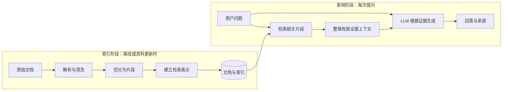
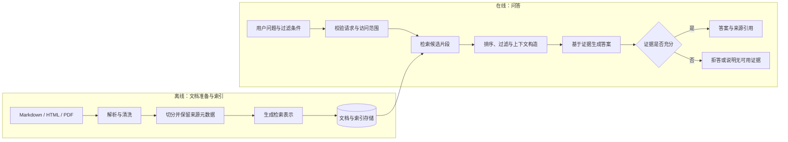

# EvidenceRAG 架构与失败模式

## Day 1：RAG 基础流程

RAG（Retrieval-Augmented Generation，检索增强生成）把外部资料检索和语言模型生成组合起来。它适合回答需要引用较新、私有或可追溯知识的问题：模型先从知识库找到证据，再根据证据组织回答。

索引阶段为后续查询做准备，不等同于模型训练；查询阶段按问题查找片段，再把问题和片段一起交给模型。检索到的内容是待核验的外部数据，不应被当成系统指令。若没有足够证据，系统应说明不确定或拒答。

Day 1 的玩具实现只用 Python 数据结构演示“检索 → 证据上下文 → 受证据约束的回答”这条控制流；它不实现真正的语义检索、文档解析或 LLM 调用。后续将逐步替换这些边界。

## 1. 系统边界

EvidenceRAG 面向知识资料使用者、知识库维护者和项目评测者。维护者导入 Markdown、HTML 或 PDF；使用者提交问题和可选过滤条件；系统从允许访问的文档中寻找证据，并返回可追溯的答案，或说明资料不足。

项目聚焦于本地启动和演示的中文 RAG 主链路。生产级高可用、企业 SSO、正式合规认证、大规模多租户和全量 MIRACL 语料索引不在范围内。项目会实现并验证演示用的权限过滤，但这不等同于完整的企业身份治理系统。

## 2. 系统概览

“生成检索表示”包括向量表示和关键词检索所需的信息；具体模型、索引实现和排序方案将在后续实验中确定。检索、上下文构造和生成过程需保留片段标识，使最终引用能追溯到来源。

## 3. 离线文档处理流程

1. **文档导入**：维护者提供支持格式的文件，系统登记文档身份和可获得的来源信息。
2. **解析与清洗**：提取正文和结构信息，去除无关内容；尽可能保留标题层级、页码或 URL。解析失败或正文为空时留下可检查的错误记录。
3. **文档切分**：把正文拆成适合检索和上下文使用的片段。每个片段保留稳定的片段 ID、所属文档 ID，以及可用的标题、页码或 URL。切分大小和重叠策略尚待实验。
4. **保存与索引**：保存片段文本和元数据，并准备向量检索与关键词检索所需的数据。项目主线计划使用 PostgreSQL + pgvector；具体表结构和索引参数在数据库阶段确定。

来源信息不能在解析或切分时丢失。若片段无法追溯至原文，后续就难以展示引用或检查回答依据。

## 4. 在线问答流程

1. **接收问题**：接收用户问题及可选的部门、文档类型、日期等过滤条件，并验证输入格式。
2. **确定访问范围**：将请求中的过滤条件与用户可访问范围结合。访问控制应在检索阶段生效，不能只在答案生成后隐藏结果。
3. **检索候选片段**：从可访问的片段中检索相关候选。项目将逐步比较向量检索、BM25 和混合检索；reranker 在后续阶段加入。
4. **排序与上下文构造**：从排序结果中选择有限数量的片段，整理成模型上下文，同时保留片段 ID 和来源元数据。需避免无关片段挤掉关键证据。
5. **生成答案**：要求模型依据提供的证据回答。证据不支持结论时，应拒答或说明资料不足。
6. **返回结果**：返回答案、引用来源和必要的拒答说明。引用必须定位到实际参与回答的文档片段。

查询改写、多查询和问题拆分是可选增强，不是首个 RAG 基线的前置条件。先完成并评测基本检索—生成链路，再决定是否加入。

## 5. 关键数据

| 对象 | 需要保存的信息 | 用途 |
|---|---|---|
| 文档 | 稳定文档 ID、文档名、来源、格式、语言，以及可获得的部门、类型、日期、权限标签 | 管理文档、过滤检索范围并为引用提供来源 |
| 片段 | 稳定片段 ID、所属文档 ID、片段文本、标题/页码/URL 等定位信息、权限及继承元数据 | 建立检索索引、控制访问并将引用定位回文档 |
| 问答请求 | 请求 ID、问题、过滤条件、运行配置和时间；日志中避免记录不必要的敏感信息 | 排查请求、比较实验和分析耗时 |
| 检索结果 | 候选片段 ID、检索方式、排序分数和顺序 | 检查召回与排序表现，分析失败案例 |
| 回答结果 | 答案、引用片段 ID、拒答状态、检索/生成耗时及可获得的 token 用量 | 展示依据、评测引用与拒答、分析成本和延迟 |

上述是逻辑信息类别，不代表最终数据库列或 API 字段；具体结构会在实现阶段结合评测、过滤和日志需要确定。

## 6. 失败模式与排查方向

| 环节 | 现象 | 可能原因 | 如何检查 |
|---|---|---|---|
| 文档解析 | 原文中的关键信息在系统片段中缺失或乱码 | PDF/HTML 解析失败、编码问题、清洗规则误删内容 | 对照原文与解析文本，确认问题首次出现在哪个解析步骤 |
| 结构与元数据 | 答案有内容，但引用没有页码、标题或可用来源 | 解析/切分时未保留定位信息，或元数据没有随片段保存 | 查看原始文档记录及对应片段，逐项检查来源字段 |
| 文档切分 | 一个片段只有问题的一半条件，检索结果不完整 | 切分边界把相邻定义、条件或表格拆开 | 查看原文位置及相邻片段，确认信息是否被拆散或丢失 |
| 检索召回 | 正确证据在知识库中，但没有出现在候选结果 | 问题和原文措辞差异大、关键词不匹配、向量表示不合适或过滤过严 | 用文档 ID 定位证据，再检查索引、各检索器候选和过滤条件 |
| 检索排序 | 正确片段在候选中，但排位靠后或未进入 top-k | 检索分数排序不理想、候选融合方式不合适 | 检查各检索器原始排名、分数、融合排名和截断位置 |
| 权限过滤 | 无权片段出现在结果中，或有权资料被错误排除 | 访问范围未在检索前应用、标签缺失或过滤组合错误 | 用不同权限标签的固定样例检查过滤前后候选和片段标签 |
| 上下文构造 | 正确片段已经检索到，但答案漏掉关键条件 | 片段被截断、上下文预算不足、重复或无关内容占据空间 | 查看实际发送给模型的上下文，核对正确证据是否保留 |
| 生成与忠实度 | 答案包含证据没有支持的事实 | 模型根据先验补全、约束不足或证据含糊 | 将答案事实逐项映射到引用片段，标记无证据支持的部分 |
| 引用 | 引用指向错误片段，或引用内容不支持对应结论 | 生成文本与片段 ID 关联丢失，或引用选择逻辑错误 | 检查引用 ID 是否属于实际上下文，并核对内容与结论 |
| 拒答 | 没证据时仍给确定答案，或有证据时过度拒答 | 拒答规则、检索阈值或证据充分性标准不合适 | 用可回答/不可回答样例分别检查候选证据、拒答状态和答案依据 |

## 7. 尚未决定的设计

- Embedding 模型、生成模型及其服务接口。
- 中文 tokenizer、片段目标长度、重叠策略，以及表格和标题的处理细节。
- BM25 实现、混合分数融合方式、候选数量和 reranker 模型。
- 证据充分性与拒答的判定方式和阈值。
- PostgreSQL 表结构、向量距离度量和 ANN 索引参数。
- 用户身份如何映射到部门/权限标签；项目先实现可验证的演示权限边界，不预设企业身份系统。

这些决定由后续实验、运行环境和工期共同约束。Day 15 前优先形成简单、可测量的端到端基线；进度吃紧时先削减可选增强策略。
